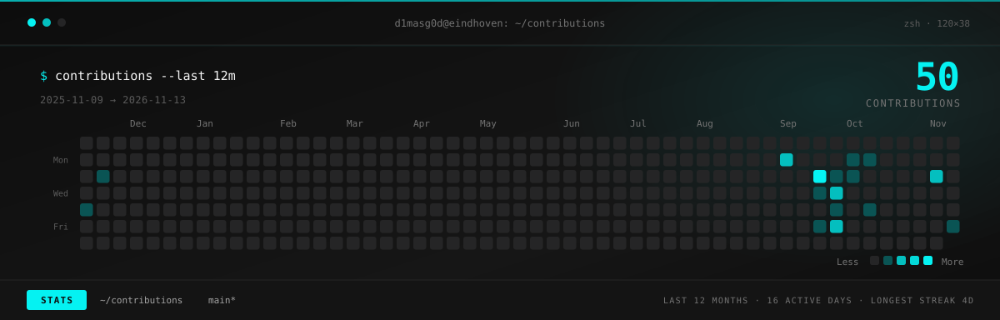

  

  

## 👨‍💻 About Me

I'm an 18-year-old developer based in Eindhoven, and I've been hooked on technology for six years. Right now I'm going all-in on infrastructure, cloud, and cybersecurity. To make that stick, I'm studying ICT at Fontys University of Applied Sciences.

- 📍 Eindhoven, The Netherlands
- 🎓 ICT student @ Fontys

## 🤝 Connect With Me

  
  
  

## 📊 Contribution Activity

  

